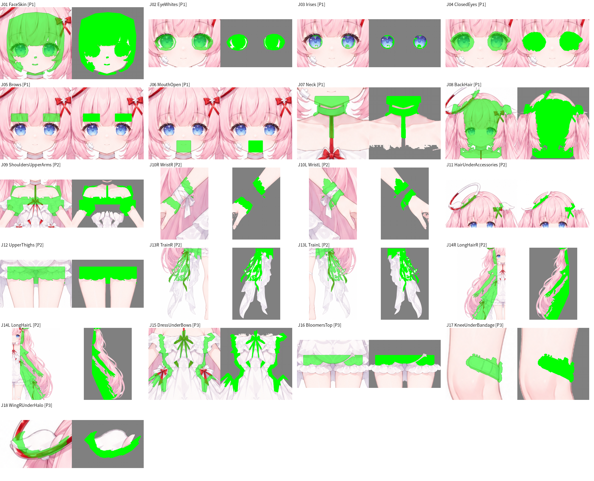

# 红理惠 Live2D 补画作业（hongPicFillJobs）

这是红理惠 Live2D 模型的补画作业包。模型的原画由设定图 [`refs/hong_4K.png`](refs/hong_4K.png) 机械拆分成 56 个图层（拆件工程在作者本机，不在本仓库）。拆开后，被前面图层挡住的地方是空的，例如刘海下的额头、完整的眼白、脸后面的头发、腿根，图层一动就会露空；眉毛、张嘴、闭眼这些原画里没有的部件也要新画。

本仓库把这些需要补画的内容整理成 **21 个图片编辑作业**。J04、J06 各有 2 个变体，所以一共要回传 23 张图。所有路径都是相对仓库根目录的相对路径。

总览图每格左边是原画上用绿色标出的范围，右边是要上传的标记版输入。

## 给执行者（包括 ChatGPT）的步骤

1. 先读本文件和 [`jobs.json`](jobs.json)。`jobs.json` 里每个作业都列出了它的文件夹、要上传的图、参考图、尺寸和回传文件名。
2. 一次只做一个作业：打开 `jobs/<作业>/prompt.md`，按里面的说明做。
   - 用 API 的图片编辑：上传 `input.png` 和 `mask.png`。
   - 用对话界面：上传 `input_marked.png`，只改纯绿色 #00FF00 的区域。
   - 把 `context.png` 和 prompt.md 里列出的 `refs/` 参考图一起附上。
   - 提示词整段复制。
3. 生成时注意：
   - 只改要画的区域，其他像素保持不变。
   - 构图、比例、画布大小都不变。
   - 部件以外的地方保持纯灰 #808080；作业 J04、J05、J06、J11 保持原来的白底。
   - 不要加文字、边框、阴影或光晕。
4. 每个作业可以多生成几张，挑最好的一张，按 `returns/<作业ID>.png` 命名，例如 `returns/J01.png`、`returns/J04_a.png`。
   - 尺寸不限，宽高比必须和输入图一样。
   - 必须输出整张图，不要裁剪。
5. 在 `returns/NOTES.md` 里记下每张用的模型、提示词有没有改动、选了第几张。项目要留来源记录。
6. 回传之后的处理由作者那边完成：
   - 按 `jobs.json` 里的 `crop4k` 和 `scale4kToImage` 把结果放回 4K 原位。
   - 普通补画：只取蒙版内、被前方图层挡住的像素，并接在原图层的下面。
   - 新部件（闭眼线、眉毛、口型）：单独提取成图层。
   - 执行者只负责生成图片，不需要做这一步。

## 建议顺序

1. **P1（J01–J08）**：眨眼、口型、转头所需的最低要求，先做。
2. **P2**：手臂、头发、拖尾运动需要。
3. **P3**：细节，最后做。

## 作业总表

| 作业 | 优先级 | 内容 | 尺寸 | 回传文件 |
| --- | :-: | --- | --- | --- |
| [J01](jobs/J01_FaceSkin/prompt.md) | P1 | 脸底层皮肤 | 1024×1024 | `returns/J01.png` |
| [J02](jobs/J02_EyeWhites/prompt.md) | P1 | 眼白 | 1536×1024 | `returns/J02.png` |
| [J03](jobs/J03_Irises/prompt.md) | P1 | 虹膜 | 1536×1024 | `returns/J03.png` |
| [J04](jobs/J04_ClosedEyes/prompt.md) | P1 | 闭眼 | 1536×1024 | `returns/J04_a.png`、`returns/J04_b.png` |
| [J05](jobs/J05_Brows/prompt.md) | P1 | 眉毛 | 1024×1024 | `returns/J05.png` |
| [J06](jobs/J06_MouthOpen/prompt.md) | P1 | 张嘴口型 | 1024×1024 | `returns/J06_a.png`、`returns/J06_b.png` |
| [J07](jobs/J07_Neck/prompt.md) | P1 | 颈部 | 1024×1024 | `returns/J07.png` |
| [J08](jobs/J08_BackHair/prompt.md) | P1 | 后脑头发 | 1024×1024 | `returns/J08.png` |
| [J09](jobs/J09_ShouldersUpperArms/prompt.md) | P2 | 肩胸与上臂 | 1536×1024 | `returns/J09.png` |
| [J10R](jobs/J10R_WristR/prompt.md) | P2 | 右手腕（画面左） | 1024×1536 | `returns/J10R.png` |
| [J10L](jobs/J10L_WristL/prompt.md) | P2 | 左手腕（画面右） | 1024×1536 | `returns/J10L.png` |
| [J11](jobs/J11_HairUnderAccessories/prompt.md) | P2 | 发饰下的头发 | 1536×1024 | `returns/J11.png` |
| [J12](jobs/J12_UpperThighs/prompt.md) | P2 | 大腿上段 | 1536×1024 | `returns/J12.png` |
| [J13R](jobs/J13R_TrainR/prompt.md) | P2 | 右拖尾（画面左） | 1024×1536 | `returns/J13R.png` |
| [J13L](jobs/J13L_TrainL/prompt.md) | P2 | 左拖尾（画面右） | 1024×1536 | `returns/J13L.png` |
| [J14R](jobs/J14R_LongHairR/prompt.md) | P2 | 右侧长发（画面左） | 1024×1536 | `returns/J14R.png` |
| [J14L](jobs/J14L_LongHairL/prompt.md) | P2 | 左侧长发（画面右） | 1024×1536 | `returns/J14L.png` |
| [J15](jobs/J15_DressUnderBows/prompt.md) | P3 | 红带和腰结下的衣身 | 1024×1024 | `returns/J15.png` |
| [J16](jobs/J16_BloomersTop/prompt.md) | P3 | 灯笼裤上部 | 1536×1024 | `returns/J16.png` |
| [J17](jobs/J17_KneeUnderBandage/prompt.md) | P3 | 左膝盖 | 1024×1024 | `returns/J17.png` |
| [J18](jobs/J18_WingRUnderHalo/prompt.md) | P3 | 右翼饰（画面左） | 1536×1024 | `returns/J18.png` |

## 约定

- **左右**：R、L 指角色自身的左右，所以 R 在画面左侧，L 在画面右侧。
- **画风**：提示词开头的“风格锁定”一段写了原画的画风和配色，配色值是从原画取样得到的，请不要改。
- **每个作业文件夹里的文件**（尺寸都相同）：
  - `input.png`：要画的区域是透明的
  - `mask.png`：OpenAI 格式的蒙版，透明的地方是要画的地方
  - `input_marked.png`：要画的区域涂成纯绿色
  - `mask_bw.png`：黑白蒙版，白色是要画的地方
  - `context.png`：同一位置的原画
  - `preview.png`：原画上标出要画的范围
  - `prompt.md`：说明和提示词
- **参考图**：说明见 [`refs/README.md`](refs/README.md)。
