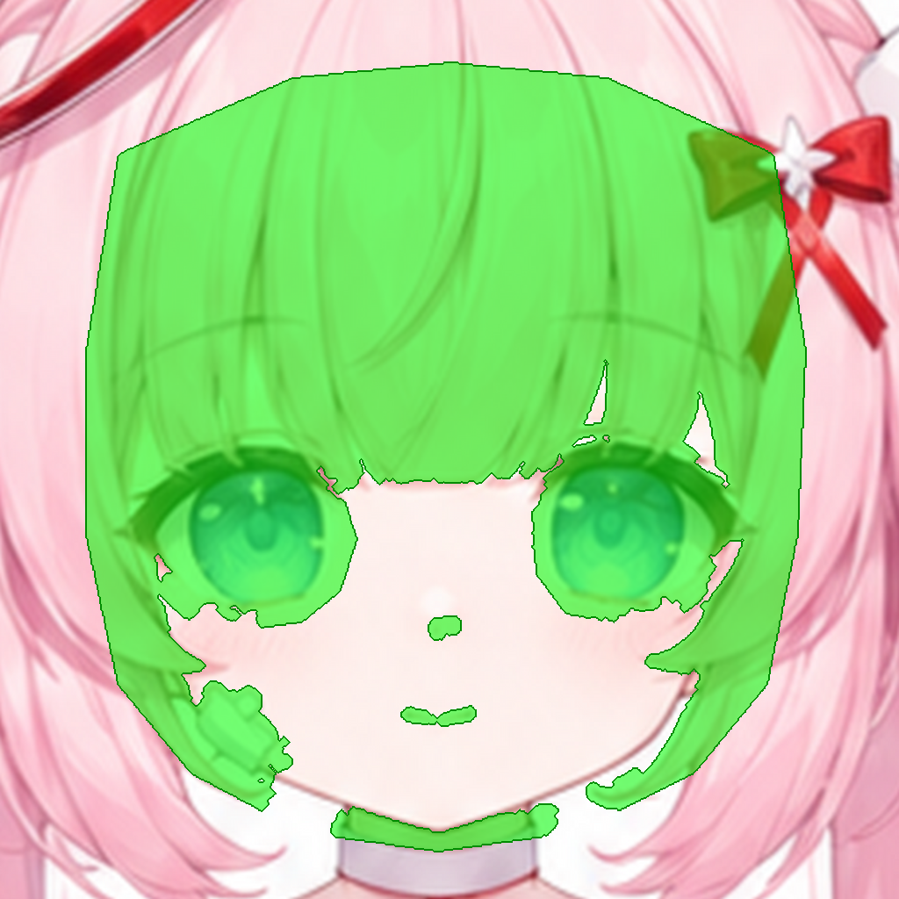

# J01 FaceSkin：脸底层皮肤（P1，必做）

## 结构说明

**脸底层皮肤 FaceSkin。** 它在模型里位于眼睛、嘴、鼻、刘海、鬓发的下面。转头、眨眼、刘海飘动时会露出额头和眼眶，所以要补成一张“没有五官的完整脸”。绿色区域包括：刘海下的额头到发际线、鬓发下的脸侧、两个眼眶、嘴和鼻的位置、创可贴下面。下巴和下颌轮廓不变。

要画的区域（绿色）：



## 要用的文件

本作业的文件都在这个文件夹里：

- **用 API 的图片编辑功能（可以带蒙版）**：上传 [`input.png`](input.png) 和 [`mask.png`](mask.png)。蒙版中透明的地方就是要画的地方。
- **用对话界面（不能传蒙版）**：上传 [`input_marked.png`](input_marked.png)。图中纯绿色 #00FF00 的区域就是要画的地方。
- **原画参考**：[`context.png`](context.png) 是同一位置的原画；[`preview.png`](preview.png) 在原画上标出了要画的范围。
- **其他工具用的黑白蒙版**：[`mask_bw.png`](mask_bw.png)，白色是要画的地方。
- **一起附上的参考图**：[`refs/hong_4K.png`](../../refs/hong_4K.png)（完整设定图（4K 处理版，拆件源））
- **尺寸**：1024×1024。生成结果只要保持这个比例，分辨率可以更高。
- **回传文件名**：`returns/J01.png`（放在仓库根目录的 `returns/` 下）

## 提示词

```text
Style lock: this is a crop of an existing anime character illustration (a pastel healing-angel girl). Match it exactly: soft anime cel shading with gentle airbrushed gradients, thin coloured line art (rose-brown on skin, deeper pink on hair, lilac-grey on white cloth), light from the upper left, pastel palette - hair #F5BCCD (shadow #E4A0B7, highlight #FEDFE5), skin #FEF0EC (shadow #F3D1D2, blush #FBD6D5), white cloth #F7F1F5 (lilac shadow #DDCEDB), red ribbon #E53B40, iris blue #7893DB.

This layer is the girl's bare face base only - no eyes, no eyebrows, no mouth, no nose line, no hair, no bandage. Fill the transparent area with continuous fair skin: the forehead up to and slightly past the hairline, the temples and cheek sides, and both eye sockets filled smoothly as skin (keep the soft pink blush under the eyes, a slightly deeper pink along the upper eye-socket edge). Keep the existing chin and jaw outline. The result is a smooth blank face ready to receive separate eye and mouth parts.

Edit rules: change ONLY the transparent area (or the pure green #00FF00 area in the marked version). Every other pixel must stay exactly as it is. Keep the flat grey #808080 background; keep the existing outlines of the body and hair, and wherever this part should not exist (outside the body or hair silhouette), paint flat grey #808080 (for full-artwork crops keep the white background). Do not add any other objects, text, borders, drop shadows or glow. Keep the same framing, scale and image size.
```
