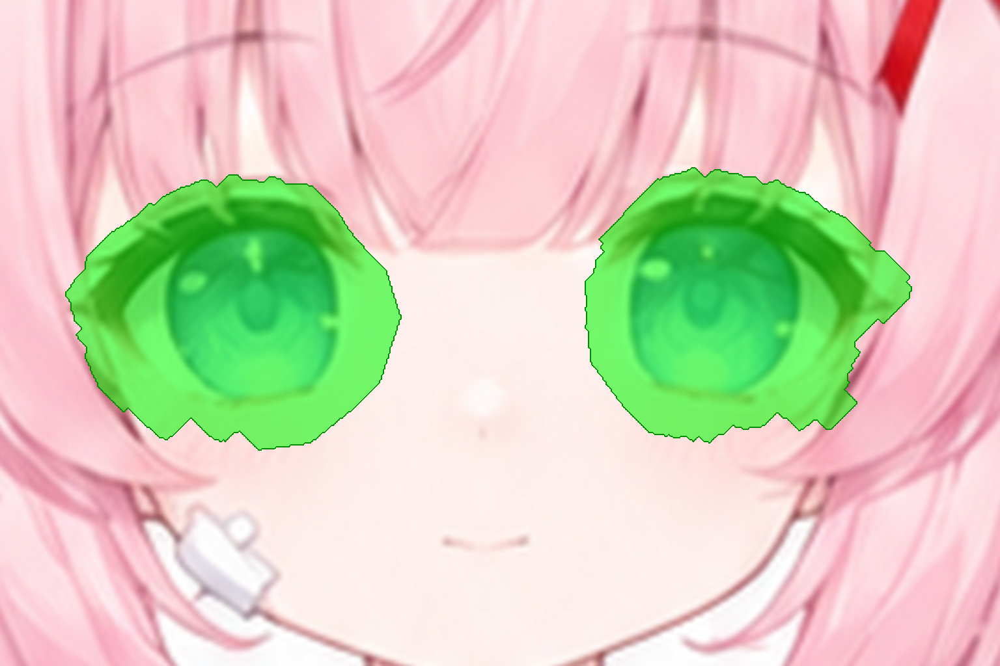

# J04 ClosedEyes：闭眼（P1，必做）

## 结构说明

**闭眼（新部件 LashClosedR / LashClosedL，可选下眼睑线）。** 在原图上把两只眼改画成闭眼，我从结果里提取闭眼睫毛线。闭眼后眼眶内只剩皮肤。闭眼线的位置和宽度要和睁眼一致。

- a：安静的闭眼（必做）
- b：开心的笑眼 ^ ^（可选）

要画的区域（绿色）：



## 要用的文件

本作业的文件都在这个文件夹里：

- **用 API 的图片编辑功能（可以带蒙版）**：上传 [`input.png`](input.png) 和 [`mask.png`](mask.png)。蒙版中透明的地方就是要画的地方。
- **用对话界面（不能传蒙版）**：上传 [`input_marked.png`](input_marked.png)。图中纯绿色 #00FF00 的区域就是要画的地方。
- **原画参考**：[`context.png`](context.png) 是同一位置的原画；[`preview.png`](preview.png) 在原画上标出了要画的范围。
- **其他工具用的黑白蒙版**：[`mask_bw.png`](mask_bw.png)，白色是要画的地方。
- **一起附上的参考图**：[`refs/game_eyes_half_closed.jpg`](../../refs/game_eyes_half_closed.jpg)（游戏立绘局部：半闭眼）
- **尺寸**：1536×1024。生成结果只要保持这个比例，分辨率可以更高。
- **回传文件名**：`returns/J04_a.png`、`returns/J04_b.png`（放在仓库根目录的 `returns/` 下）

## 提示词（变体 a）

```text
Style lock: this is a crop of an existing anime character illustration (a pastel healing-angel girl). Match it exactly: soft anime cel shading with gentle airbrushed gradients, thin coloured line art (rose-brown on skin, deeper pink on hair, lilac-grey on white cloth), light from the upper left, pastel palette - hair #F5BCCD (shadow #E4A0B7, highlight #FEDFE5), skin #FEF0EC (shadow #F3D1D2, blush #FBD6D5), white cloth #F7F1F5 (lilac shadow #DDCEDB), red ribbon #E53B40, iris blue #7893DB.

In this crop of the finished artwork, redraw ONLY the green/transparent eye areas so that both eyes are closed: calm, relaxed closed eyes - a soft downward-curved lid line, like peaceful sleep. Use the same dark brown lash colour (#5F3841, darkest #392131) and the same line weight as the open upper lashes, keep a small lash flick at the outer corners. Inside the closed eye there is only skin with the existing blush. Keep each closed eye at exactly the same position and width as the open eye. Bangs, face and everything else unchanged.

Edit rules: change ONLY the transparent area (or the pure green #00FF00 area in the marked version). Every other pixel must stay exactly as it is. Keep the flat grey #808080 background; keep the existing outlines of the body and hair, and wherever this part should not exist (outside the body or hair silhouette), paint flat grey #808080 (for full-artwork crops keep the white background). Do not add any other objects, text, borders, drop shadows or glow. Keep the same framing, scale and image size.
```

## 提示词（变体 b）

```text
Style lock: this is a crop of an existing anime character illustration (a pastel healing-angel girl). Match it exactly: soft anime cel shading with gentle airbrushed gradients, thin coloured line art (rose-brown on skin, deeper pink on hair, lilac-grey on white cloth), light from the upper left, pastel palette - hair #F5BCCD (shadow #E4A0B7, highlight #FEDFE5), skin #FEF0EC (shadow #F3D1D2, blush #FBD6D5), white cloth #F7F1F5 (lilac shadow #DDCEDB), red ribbon #E53B40, iris blue #7893DB.

In this crop of the finished artwork, redraw ONLY the green/transparent eye areas so that both eyes are closed: happy smiling closed eyes - gentle upward-curved arcs (^ ^). Use the same dark brown lash colour (#5F3841, darkest #392131) and the same line weight as the open upper lashes, keep a small lash flick at the outer corners. Inside the closed eye there is only skin with the existing blush. Keep each closed eye at exactly the same position and width as the open eye. Bangs, face and everything else unchanged.

Edit rules: change ONLY the transparent area (or the pure green #00FF00 area in the marked version). Every other pixel must stay exactly as it is. Keep the flat grey #808080 background; keep the existing outlines of the body and hair, and wherever this part should not exist (outside the body or hair silhouette), paint flat grey #808080 (for full-artwork crops keep the white background). Do not add any other objects, text, borders, drop shadows or glow. Keep the same framing, scale and image size.
```
