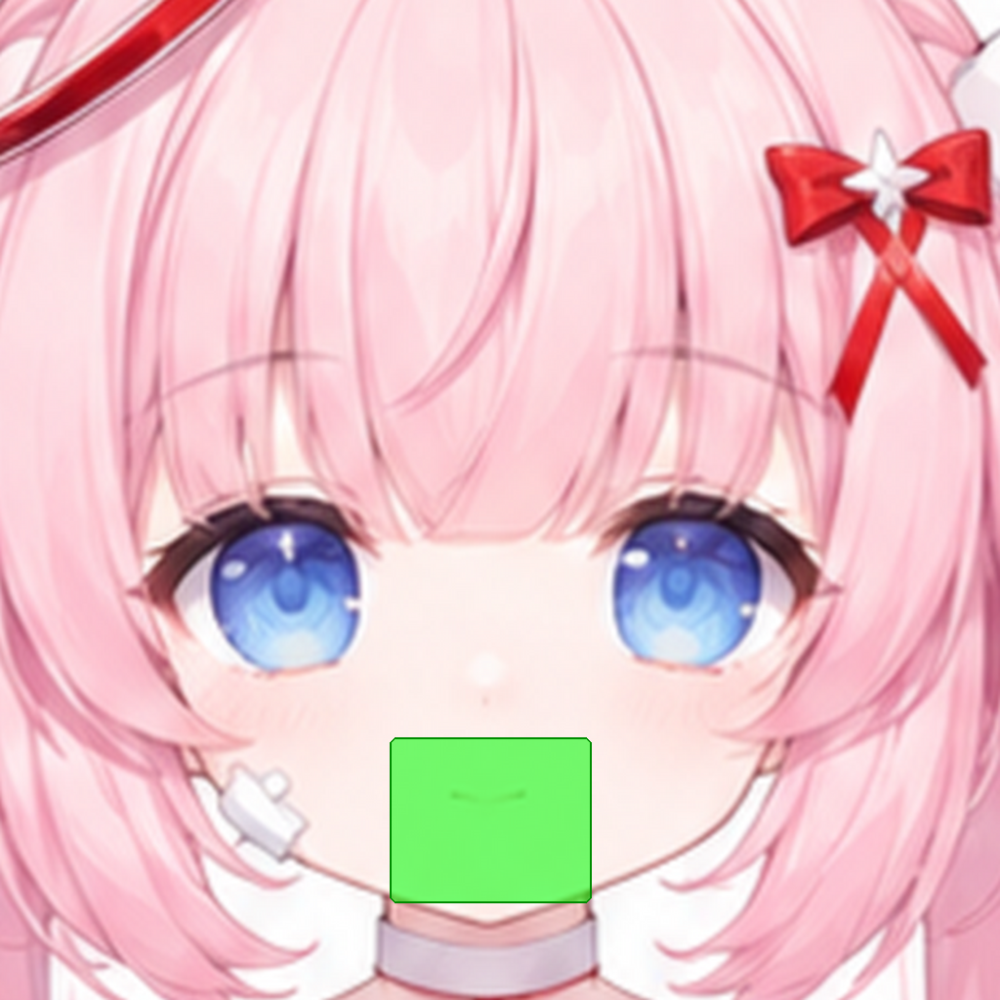

# J06 MouthOpen：张嘴口型（P1，必做）

## 结构说明

**张嘴口型（新部件：口腔、上唇线、下唇线、牙、舌）。** 在原图上把嘴改画成张开状态，我从结果里拆出各口型部件。大小比例要和原来的小嘴一致，位置居中不变。

- a：说“啊”时的中等张口（必做）
- b：微笑张口（可选）

要画的区域（绿色）：



## 要用的文件

本作业的文件都在这个文件夹里：

- **用 API 的图片编辑功能（可以带蒙版）**：上传 [`input.png`](input.png) 和 [`mask.png`](mask.png)。蒙版中透明的地方就是要画的地方。
- **用对话界面（不能传蒙版）**：上传 [`input_marked.png`](input_marked.png)。图中纯绿色 #00FF00 的区域就是要画的地方。
- **原画参考**：[`context.png`](context.png) 是同一位置的原画；[`preview.png`](preview.png) 在原画上标出了要画的范围。
- **其他工具用的黑白蒙版**：[`mask_bw.png`](mask_bw.png)，白色是要画的地方。
- **一起附上的参考图**：[`refs/game_mouth_talking.jpg`](../../refs/game_mouth_talking.jpg)（游戏立绘局部：张口说话）
- **尺寸**：1024×1024。生成结果只要保持这个比例，分辨率可以更高。
- **回传文件名**：`returns/J06_a.png`、`returns/J06_b.png`（放在仓库根目录的 `returns/` 下）

## 提示词（变体 a）

```text
Style lock: this is a crop of an existing anime character illustration (a pastel healing-angel girl). Match it exactly: soft anime cel shading with gentle airbrushed gradients, thin coloured line art (rose-brown on skin, deeper pink on hair, lilac-grey on white cloth), light from the upper left, pastel palette - hair #F5BCCD (shadow #E4A0B7, highlight #FEDFE5), skin #FEF0EC (shadow #F3D1D2, blush #FBD6D5), white cloth #F7F1F5 (lilac shadow #DDCEDB), red ribbon #E53B40, iris blue #7893DB.

Redraw only the mouth inside the green box as a small, cute open mouth saying 'ah' (moderately open, rounded). Use a thin rose-brown lip line (#C98A92), dark rose inner mouth (#A8424F to #7A2836), a hint of white upper teeth (#FFF8F8) under the upper lip and a small pink tongue (#E87C8A) at the bottom. Keep the same small scale as the original mouth, centred on the same spot. Everything outside the box unchanged.

Edit rules: change ONLY the transparent area (or the pure green #00FF00 area in the marked version). Every other pixel must stay exactly as it is. Keep the flat grey #808080 background; keep the existing outlines of the body and hair, and wherever this part should not exist (outside the body or hair silhouette), paint flat grey #808080 (for full-artwork crops keep the white background). Do not add any other objects, text, borders, drop shadows or glow. Keep the same framing, scale and image size.
```

## 提示词（变体 b）

```text
Style lock: this is a crop of an existing anime character illustration (a pastel healing-angel girl). Match it exactly: soft anime cel shading with gentle airbrushed gradients, thin coloured line art (rose-brown on skin, deeper pink on hair, lilac-grey on white cloth), light from the upper left, pastel palette - hair #F5BCCD (shadow #E4A0B7, highlight #FEDFE5), skin #FEF0EC (shadow #F3D1D2, blush #FBD6D5), white cloth #F7F1F5 (lilac shadow #DDCEDB), red ribbon #E53B40, iris blue #7893DB.

Redraw only the mouth inside the green box as a small happy open smile (wider, gentle cat-like smile, only slightly open). Use a thin rose-brown lip line (#C98A92), dark rose inner mouth (#A8424F to #7A2836), a hint of white upper teeth (#FFF8F8) under the upper lip and a small pink tongue (#E87C8A) at the bottom. Keep the same small scale as the original mouth, centred on the same spot. Everything outside the box unchanged.

Edit rules: change ONLY the transparent area (or the pure green #00FF00 area in the marked version). Every other pixel must stay exactly as it is. Keep the flat grey #808080 background; keep the existing outlines of the body and hair, and wherever this part should not exist (outside the body or hair silhouette), paint flat grey #808080 (for full-artwork crops keep the white background). Do not add any other objects, text, borders, drop shadows or glow. Keep the same framing, scale and image size.
```
