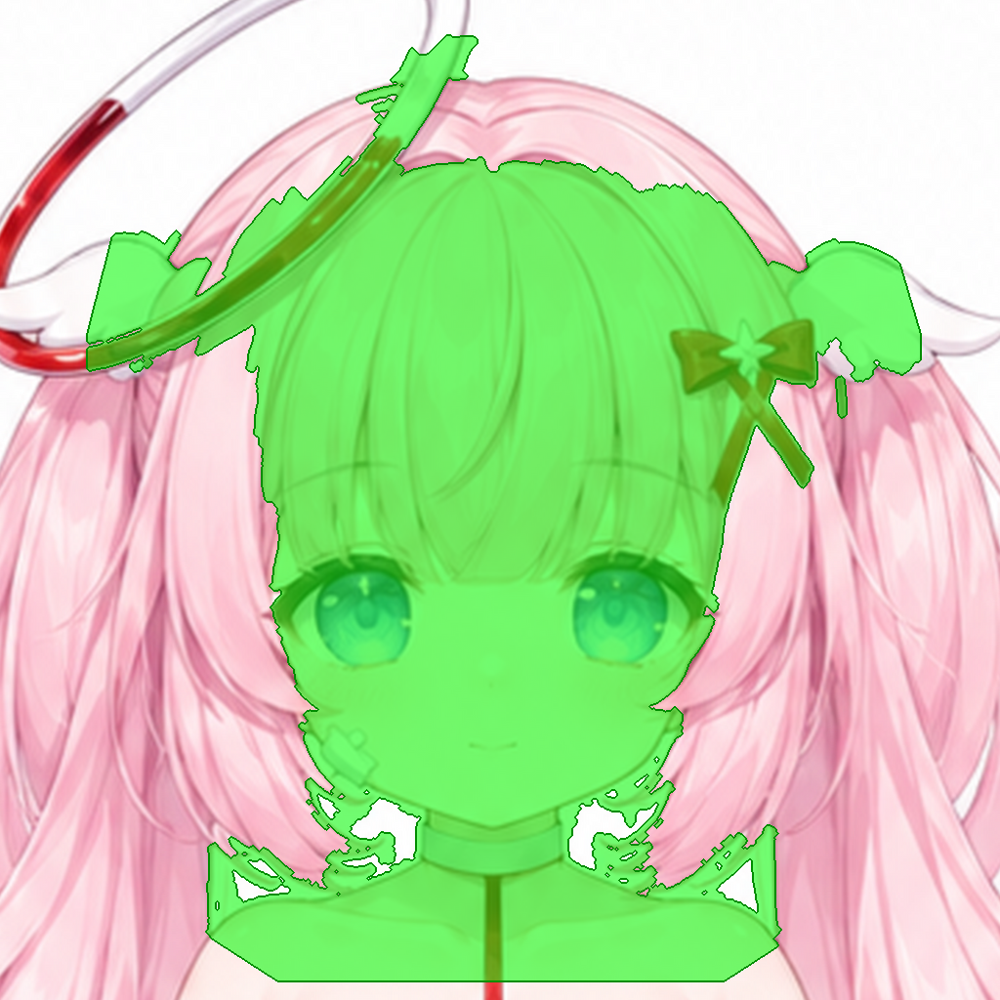

# J08 BackHair：后脑头发（P1，必做）

## 结构说明

**后脑头发 HairBack。** 去掉脸、刘海、发饰之后，看到的是后脑勺内侧的头发。转头或刘海飘起时会露出。发旋在头顶中央，发丝向下流，两侧往双马尾方向走，在脖子和肩膀后面继续往下。可以参考设定图的背面视图。

要画的区域（绿色）：



## 要用的文件

本作业的文件都在这个文件夹里：

- **用 API 的图片编辑功能（可以带蒙版）**：上传 [`input.png`](input.png) 和 [`mask.png`](mask.png)。蒙版中透明的地方就是要画的地方。
- **用对话界面（不能传蒙版）**：上传 [`input_marked.png`](input_marked.png)。图中纯绿色 #00FF00 的区域就是要画的地方。
- **原画参考**：[`context.png`](context.png) 是同一位置的原画；[`preview.png`](preview.png) 在原画上标出了要画的范围。
- **其他工具用的黑白蒙版**：[`mask_bw.png`](mask_bw.png)，白色是要画的地方。
- **一起附上的参考图**：[`refs/design_sheet.png`](../../refs/design_sheet.png)（角色设计表（正面、背面、侧面，含配色））；[`refs/three_views.png`](../../refs/three_views.png)（三视图（含背面长发））
- **尺寸**：1024×1024。生成结果只要保持这个比例，分辨率可以更高。
- **回传文件名**：`returns/J08.png`（放在仓库根目录的 `returns/` 下）

## 提示词

```text
Style lock: this is a crop of an existing anime character illustration (a pastel healing-angel girl). Match it exactly: soft anime cel shading with gentle airbrushed gradients, thin coloured line art (rose-brown on skin, deeper pink on hair, lilac-grey on white cloth), light from the upper left, pastel palette - hair #F5BCCD (shadow #E4A0B7, highlight #FEDFE5), skin #FEF0EC (shadow #F3D1D2, blush #FBD6D5), white cloth #F7F1F5 (lilac shadow #DDCEDB), red ribbon #E53B40, iris blue #7893DB.

This shows only the back and side hair of the girl, with the face, bangs and accessories removed. Fill the transparent area with the inner back of the head hair as seen from the front, behind the face: pale pink hair (#F5BCCD), a little darker in the centre and towards the neck (#E4A0B7), strands flowing down from the crown at the top centre and sweeping outward towards the twin tails on both sides, continuing down behind the neck and shoulders. No face, no bangs, no ears, no accessories. Same hair style and line art as the visible hair. (See the attached design sheet back view.)

Edit rules: change ONLY the transparent area (or the pure green #00FF00 area in the marked version). Every other pixel must stay exactly as it is. Keep the flat grey #808080 background; keep the existing outlines of the body and hair, and wherever this part should not exist (outside the body or hair silhouette), paint flat grey #808080 (for full-artwork crops keep the white background). Do not add any other objects, text, borders, drop shadows or glow. Keep the same framing, scale and image size.
```
